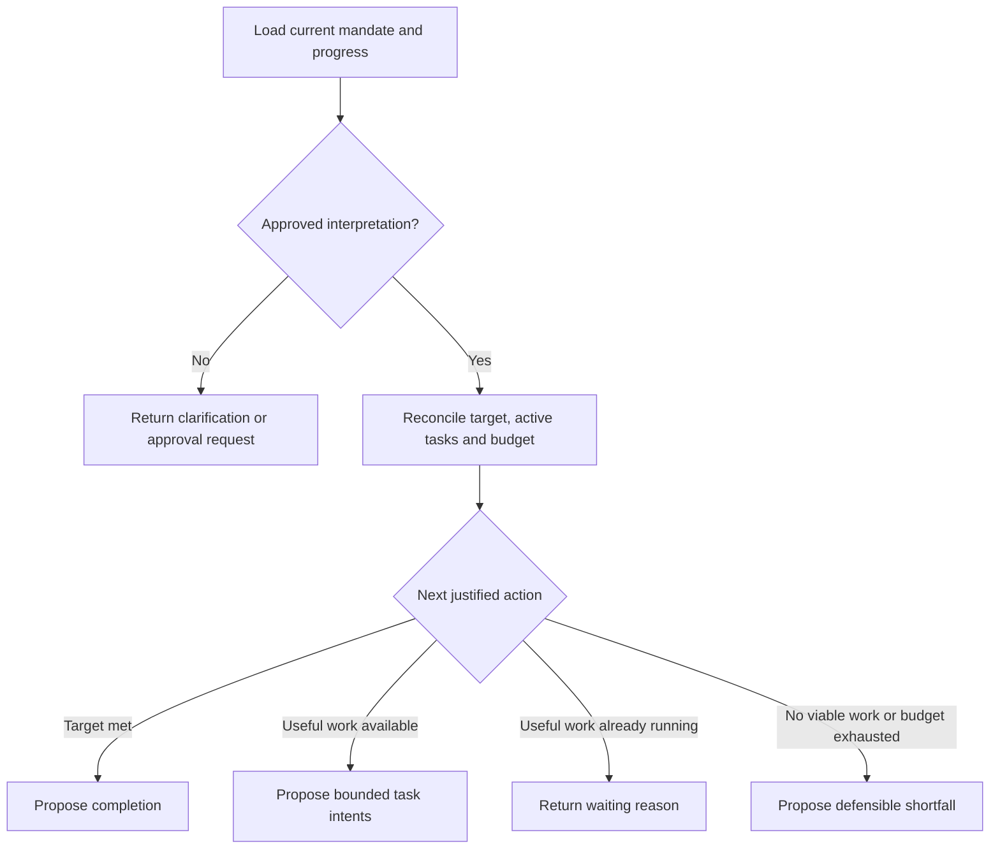
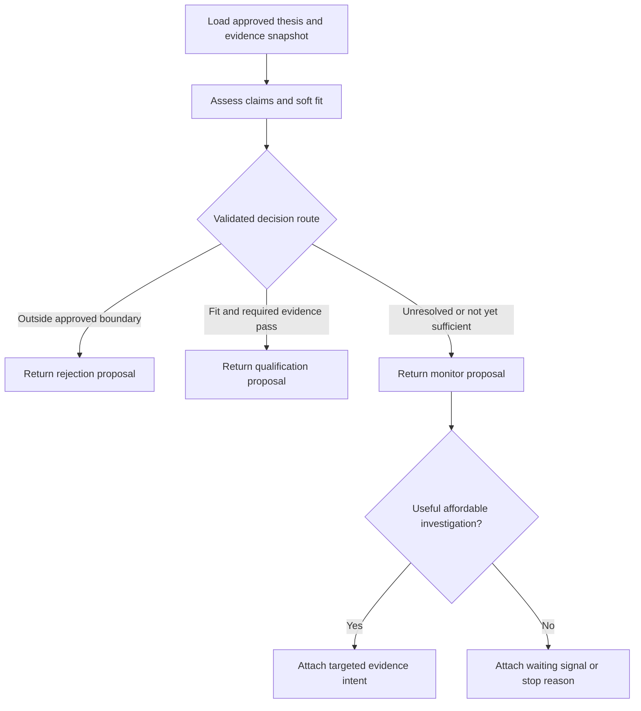

# ThesisOS two-agent discussion and provisional plan

Status: Discussion draft; human policy choices recorded, architecture proposals not approved for implementation.
Last updated: 24 October 2026 (IST).
Scope: planning only. Deadline 5:45 PM IST; three-minute vision demo. No runtime changes authorized here.

## Objective and current position

Clarify what the mandate orchestrator decides next and how the company matcher interprets evidence, so the demo can show accountable sourcing and a justified revisit. Success for this planning phase is an understandable decision policy, small graph sketches, explicit ownership, and a reviewable handoff. It is not a working semantic agent.

The user has answered the initial intent questions. The next discussion should walk one case through this policy using the actual thesis when supplied. Do not invent that thesis or fund history.

## Human decisions and source traceability

| Decision | Human evidence | Implication |
|---|---|---|
| Reject outside the decision boundary and allowed wiggle room; otherwise monitor until qualification | “the decision boundary and wiggle room decides the reject, otherwise have everything else in monitor, if it's past the threshold then qualify” | Use reject/monitor/qualify as business judgments; distinguish operational work separately. Exact boundary and threshold remain undefined. |
| Human reviews outreach after qualification | “once qualified the outreach is human review-ed” | Prepare a reviewable package; do not infer authority to send. Whether review acceptance is required before counting outreach_ready remains open. |
| Success is outreach-ready companies with relevant person and reviewable draft | “I think former” in response to outreach-ready versus qualified-only success | Retain the current target_state=outreach_ready. Qualification alone does not satisfy the mandate. |
| Stay within the thesis | “for now let's stick to the thesis” | No separate outside-thesis exception pipeline in this scope. |
| Qualification needs fit and required evidence | “Require fit and required evidence” | Unknown required claims block qualification, without themselves establishing rejection. |
| Past funded companies inform wiggle room, focused on soft preferences | “what should be taken into consideration is also the past companies that were funded to figure our how much of wiggle room has been allowed before. but soft preferences should be the right angle” | Include an authentic precedent lens for soft-fit interpretation. It does not authorize overriding hard constraints or fabricating history. |

Fixed brief boundaries: material mandate interpretation requires human approval; matcher returns proposals; backend owns authoritative transitions; no hidden chain-of-thought requests or promises. Numeric thresholds remain uncalibrated proposals unless supported by human decisions/evidence.

Source proposals: Initial Technical Spec P0031–36 (agent inputs/outputs), P0056–65 (versions and transactions), P0087–92 (criteria and precedents). Design Thinking P0035–50 (state and decisions), P0051–68 (three lenses and separate assessment concepts), P0070–82 (journey/demo). Source imperative language is not implementation authorization.

## Grounded current system

Inspected contracts/v0.1.md, handoffs/backend.md, and backend/app/{models,providers,evaluators,state,runner}.py. This is a read-only snapshot of active work, not a frozen implementation contract.

- SQLite StateService owns saved mandates, cases, evidence, immutable evaluations, events and tasks. InProcessRunner executes one combined discover_and_evaluate task with one worker. It is not Dramatiq or a durable queue.
- Evaluator.evaluate currently receives mandate, case_id, fixture_key, evidence, evaluation_id and created_at; it returns Evaluation plus optional OutreachPackage. There is no genuine semantic evaluation or graph budget loop.
- The source code is ahead of the backend handoff: CrustdataSearchProvider now exists with an explicitly configured bounded query. Its presence does not prove this chat executed it, actual coverage, or thesis-derived search. No provider calls were made here.
- The fixture evaluator is independent of thesis meaning. For nonfixture candidates it preserves unknown thesis match, returns needs_evidence, and identifies itself as a development placeholder.
- StateService._evaluate calls the evaluator inside a write transaction and applies its recommendation. A network/model-based matcher needs a snapshot/evaluate/conditionally-commit boundary, not a slow model call inside that transaction.
- Models contain version fields, but the inspected evaluator interface does not pass an expected case version or evidence snapshot, and application of its result lacks the proposed stale-result precondition. Mandate edits/version increments are deferred. Do not claim stale-version protection is complete because the contract lists an error name.
- The current contract includes needs_evidence and investigating. The user's monitor-first judgment policy does not itself authorize deleting or renaming existing wire statuses.

## Boundary model for discussion

| Boundary | Owns | Does not decide |
|---|---|---|
| Mandate orchestrator graph | Parse/propose criteria; choose complementary search hypotheses; reconcile accepted progress, outstanding work and budget; propose next bounded work or stopping reason | Final evidence truth, case database commits, provider transport/retries, outreach sending |
| Company matcher graph | Interpret one company's evidence against the approved thesis and optional precedents; identify decision-relevant gaps; request bounded research; return typed assessment and disposition proposal | Rewrite thesis, change business state, freely schedule jobs, convert attractive exceptions into in-thesis fits |
| Business-state service | Validate authority, policy version, evidence references, allowed transitions, deduplication and budget; atomically accept or reject proposals; save events/evaluations | Invent semantic fit |
| Task runner/adapters | Execute approved bounded operations; report outcomes and execution failures | Investment policy, autonomous mandate expansion |
| Human | Approve material interpretation; review outreach; own final policy choices | — |

LangGraph state is the working snapshot of an invocation: input versions, unresolved claims, proposed requests, visited queries, remaining allowance and result. Saved business state is accepted mandate policy, evidence, decisions, budget ledger, history and approvals. Task state is pending/running/succeeded/failed execution. A graph reaching END does not make a mandate completed; a task succeeding does not make a company qualified.

LangGraph provides nodes, shared state and conditional edges; nodes can use models or deterministic code. Its checkpoints can persist a graph execution, but this design keeps business authority in the state service. Official references checked 24 October: [Graph API](https://docs.langchain.com/oss/python/langgraph/graph-api), [persistence](https://docs.langchain.com/oss/python/langgraph/persistence).

## Minimal graph sketches — proposals

Orchestrator is a short-lived invocation on run request or meaningful accepted event. It reads saved progress rather than waiting in a permanent loop.

Matcher starts with the approved criteria and a versioned evidence snapshot. For the smallest demo, return one targeted evidence intent and end; a new invocation reassesses after accepted evidence arrives. A bounded synchronous tool loop is an alternative if permitted tools and latency are small. This avoids making graph checkpoint recovery a prerequisite for the first demonstration.

In the return-and-reinvoke variant, the actual loop is business event → new matcher invocation, not an unbounded internal graph loop. Assessment and routing stay logically separate even if the demo combines nodes.

Human approval can later use LangGraph interrupts with checkpointing; resumed interrupt nodes restart, so side effects before an interrupt must be safe to repeat. The minimal alternative is a persisted approval request followed by a fresh invocation from current business state. These are options, not a selected dependency. [Official interrupt documentation](https://docs.langchain.com/oss/python/langgraph/interrupts).

## Decision policy and evidence

| Condition | Proposed business judgment | Next action / evidence |
|---|---|---|
| Reliable evidence establishes failure of an explicit non-negotiable criterion | Reject | Cite criterion and observations; state what could change the decision |
| Soft fit falls outside the approved acceptable range with adequate evidence | Reject | Explain which preference fails and why precedents do not justify permitted flexibility |
| Required claim unknown, contested, stale, or insufficiently evidenced | Monitor | Investigate a specific gap if useful and affordable; otherwise name waiting signal |
| Fit is not yet sufficient, but no justified rejection | Monitor | Record unmet condition and what change would matter; avoid perpetual generic research |
| Fit passes and each required claim has adequate evidence | Qualify | Prepare relevant person, why-company/why-now rationale and reviewable draft |
| Qualified but person/source/draft/readiness details incomplete | Remain qualified | Complete package; do not count toward outreach-ready target yet |
| Complete package available | Propose outreach_ready | Human review remains required for outreach; exact count-before/after-review semantics open |
| Provider/model task fails | Operational failure, not rejection | Preserve prior accepted judgment; record failure and retry eligibility |

Monitor is the user's business bucket. Active investigation versus waiting should be expressed by next_action and task state. Possible future additive judgment metadata could keep this separate from current operational statuses; no wire change is made here.

Keep four questions separate: fit (matches thesis?), evidence sufficiency (supported enough?), attractiveness (interesting within thesis?), and actionability (ready for a useful handoff?). A high aggregate score cannot compensate for a hard failure or required unknown. The current fit/evidence numbers can stay null; no 0.7/0.8 or other numerical cutoff is approved.

Semantic work: product/category interpretation, founder/context relevance, soft-fit tradeoffs, relevance of historical analogues, evidence conflicts, and which missing fact could change the judgment. Deterministic validation: IDs, allowed task types, evidence references, version equality, budget availability, duplicate work, timestamps, required fields, and qualification gates. A semantic classification should carry evidence and a reviewable explanation before a deterministic hard-constraint rule uses it.

Each claim retains supported/contradicted/unknown plus evidence IDs and dates. Preserve conflicting observations explicitly; do not reduce conflict to an unexplained score. Provider copies of the same underlying source are not independent corroboration. A proxy such as hiring growth does not establish revenue. Explain decisive factors, alternatives and uncertainty; no private reasoning transcript is needed.

Precedents should be authentic and assessed at investment time, with source dates, relevance and differences. Present-day winners create survivorship/hindsight bias; absence of declined deals limits learning a boundary. Use precedents as evidence for soft-preference interpretation, not as an automatically learned fund policy or extra mandatory requirement. If missing, say unavailable; assess with the explicit thesis and present evidence. If a precedent would require changing a hard constraint or material interpretation, ask for mandate approval/version change.

## Proposed interfaces — discussion contracts only

Not implemented, not added to v0.1; extra fields are currently forbidden by runtime models.

- ApprovedMandateView: exact source text; thesis/policy version; criterion IDs; hard versus soft; required evidence; ambiguity/approval record; target; resource envelope. Approval covers material normalization rather than being inferred from reference_status=user_supplied.
- TaskIntent: allowed kind (discover, investigate_claim, evaluate_case, prepare_outreach); mandate/case IDs; thesis/policy and expected case versions; evidence snapshot reference; criterion/claim target; bounded tool/query parameters; priority and decision-changing rationale; idempotency key; reserved cost/time/call allowance. Graph output is a request. Service acceptance creates a task; only the runner executes it.
- MatcherResult: assessment of four separate concepts; claim/criterion findings and evidence IDs; approved-version references; proposed reject/monitor/qualify judgment; missing required claims; concise decision explanation; optional targeted investigation; reopening condition; stop reason; model/prompt version; per-source provenance. Match current Evaluation fields where possible; any extensions require control-owner review.
- OrchestrationResult: validated proposed intents or waiting/completion/shortfall proposal, accepted progress snapshot, budget summary and reason. Outstanding viable tasks prevent premature exhaustion claims.

Do not add attractive but unsupported fields to Crustdata requests; adapter capabilities must constrain intent validation.

## Investigation, stopping, reopening and failure

Budget proposals need separate mandate and per-case envelopes for calls, tokens/cost, elapsed time and attempts, including reservations for active work. No numeric amounts are selected. Select a gap when answering it could change rejection, qualification or readiness and an allowed source can plausibly answer it. This prioritization can be qualitative; no invented expected-value formula is required.

Stop a matcher pass on justified rejection, qualification, exhausted allowance, unavailable useful sources, deadline, invalid inputs, or no new decision-relevant evidence. No repeated identical investigation without a new source/signal. Exhaustion keeps unresolved claims unknown and usually monitor; it never proves non-fit. Orchestrator ends with target met, waiting, or an explained shortfall. Aggregate provider failure should be distinguished from evidence scarcity.

Reopen monitored or rejected cases only when accepted, relevant new evidence or an approved thesis revision could affect a previously decisive criterion. Deduplicate signals; preserve old assessment, rejection reason, triggering evidence and new assessment. A soft-positive signal does not erase an unchanged hard failure. Reassessment may confirm the prior judgment. Negative material evidence can also invalidate a previously qualified/ready case; stale packages should cease counting, subject to agreed freshness policy.

Before accepting output, compare thesis/policy version, case version and evidence snapshot to current state. If stale, do not overwrite accepted judgment or consume the intent twice; record supersession and reassess from fresh input if useful within the remaining budget. Malformed model output, nonexistent evidence references, unsupported tool requests and unjustified qualification fail validation. A bounded repair/retry may be permitted; otherwise return an observable operational failure, preserving the previous accepted case decision.

## Options and tradeoffs

| Option | Favored when | Cost / limit |
|---|---|---|
| Short graph passes; returned task intents; reinvoke on accepted evidence | Small demo, current runner/persistence, clear audit trail | Needs explicit orchestration of the next pass; no claim of durable graph resume |
| Bounded internal research loop | Few quick permitted lookups, tight latency budget | Must meter every call, avoid repeated queries and commit only against a current snapshot |
| Persisted interrupt/resume | Human waits and long graph continuity become central | Additional checkpoint lifecycle, resume/version handling and idempotency work |

Keep SQLite and in-process execution for the demo if adequate; preserve ownership despite sharing a process. PostgreSQL, Dramatiq, transactional outbox, leases and wider concurrency are later reliability proposals, not prerequisites or completed capabilities.

## Now / Next / Later and acceptance

**Now — finish policy discussion.** Record the confirmed authority and success choices; inspect authentic thesis/predecessor data when supplied; walk one case through reject/monitor/qualify and readiness. Acceptance: every disposition has a criterion, evidence/unknowns, next action and stop/reopening reason. Resolve whether human acceptance precedes outreach-ready counting and how required claims/soft-fit qualification are defined.

**Next — propose one minimal demo slice for the implementation owners.** One mandate, real provider observations, genuine semantic assessment if runtime access exists, one monitor gap, one targeted/labeled new signal, saved before/after decision, and a reviewable outreach package if justified. Acceptance: unknowns block qualification, replay does not force promotion, hard failure survives irrelevant positive news, duplicate signals do not multiply work, stale results cannot overwrite newer decisions, target/shortfall is honest. These are proposed acceptance scenarios, not tests run here. No production infrastructure rewrite implied.

**Later — only after the story works.** Authentic precedent retrieval and partner feedback calibration; broader monitoring/freshness; durable queue/outbox and checkpoint resume if needed. Acceptance: historical examples are traceable, policy changes require approval/versioning, spend respects envelopes, retries/recovery preserve accepted business state.

## Cold pickup and ownership

Latest direction: the human requests the decision-policy discussion as the core framework, an agent constitution, complete system prompts for each role, and explicit state-conditioned prompt behavior. Current drafts: constitution-and-policy-draft.md, loop-operating-spec.md and system-prompts-draft.md. They confirmed always assessing why-now while gating qualification only when the mandate requires it, and evaluating the whole founder case with pedigree as supporting evidence. They endorsed the joint company/team context → assessment → targeted investigation → rebuilt-context reassessment loop. They explicitly authorized a coordination message to control chat 01a16c48-1fe3-70b3-bc93-63a1dddb4e2c with backend-versus-LangGraph responsibilities. LangGraph/agent design remains here, backend foundations remain in the existing backend chat. Prompt text/internal contracts are provisional; no runtime work has been done here.

Last completed: read source texts, contract and actual backend interfaces; clarified policy with the human; documented the endorsed joint-context loop, exact ownership/continuation protocol and full provisional system prompts/state tasks. Current documents are listed above. No code, schemas, fixtures, shared contracts, credentials or other owners' handoffs changed. No services, installs, paid calls or agents started. The human authorized a coordination message to the named control chat; delivery status belongs in handoffs/agents-design.md.

Open questions: actual thesis and authentic investment-time precedent availability; criterion-specific soft flexibility; required claims and sufficient fit definition; investigation allowances; whether human review acceptance gates counting outreach_ready; signal materiality/freshness rules. Do not block active backend/frontend builds on this planning discussion.

Exact next action: send the authorized backend-versus-LangGraph coordination handoff to control, then refine the prompt/graph drafts here against the reviewed thesis and backend-agreed internal seam. Clarify outreach-ready review semantics and attractiveness gating with the human. Master control owns shared contract acceptance; the existing backend chat owns foundation implementation. No runtime agent implementation was performed here.
