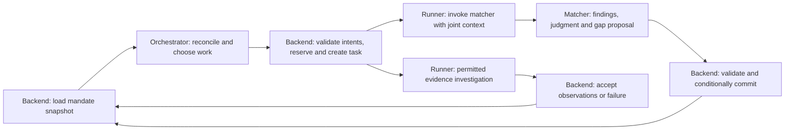

# Two-agent evidence loop: operating specification and ownership

Status: human endorsed the joint assessment/investigation/reassessment loop; detailed interfaces, node layout and reliability mechanisms below are design proposals. Planning artifacts only, 24 October 2026 (IST).

Implementation update: the human subsequently authorized building/testing agents here. agents/ now contains the compiled graph/prompt/guard slice and thesis-led discovery planning. Backend event/task/persistence mechanisms described below remain owner integration work, not implemented by this chat. See handoffs/agents-design.md for exact current interfaces and mocked versus real API proof. Original design below is retained for rationale; executable contracts/prompts live under agents/.

Manual qualification update: contracts/human-qualification-v0.1.md settles the authority. Matcher recommends qualify; backend stores the proposal without qualified transition; a distinct human application action approves a current immutable assessment. Backend owns versions/eligibility/idempotency and supplies current human-approval metadata to orchestration. prepare_outreach and readiness counting require that current accepted qualification. Agents cannot create the approval; optional extra draft review is a different rule. Earlier graph/decision wording is recommendation-only and must be read with this boundary.

Primary discussion policy: constitution-and-policy-draft.md. Draft prompts: system-prompts-draft.md. Coordination summary: ../../handoffs/agents-design.md.

## Non-negotiable outcome of this design

A company profile and its linked founder/team evidence must be considered together against the approved thesis and relevant market evidence before substantive qualification. The matcher develops an evidence-linked team–problem fit judgment and clearly answers why-this, why-them and why-now. It identifies a specific decision-changing gap, rather than requesting generic profile enrichment. The system can gather evidence, rebuild the joint context and reassess without losing the previous judgment, changing the thesis or forcing promotion.

The human said this loop makes sense and must be documented well. They assign LangGraph/agent design work to this chat and ask that the control chat be informed of the split with the existing backend foundation chat. This updates the earlier no-messaging restriction only for the explicitly named control chat; it does not authorize messages to other chats, additional agents or runtime implementation here.

## One ownership model

| Responsibility | Owner | Boundary |
|---|---|---|
| Decide what a company's evidence means | Matcher graph | Returns assessment and investigation proposals; no queue/database authority |
| Decide what mandate work to prioritize next | Orchestrator graph | Returns task intents or waiting/completion/shortfall proposals; no worker execution |
| Validate proposals and accept transitions | Backend state/application service | Approved versions, evidence references, allowed transitions, budgets and deduplication |
| Execute an accepted investigation | Backend runner and permitted provider/tool adapters | Returns sourced observations or typed failure; does not decide investment policy |
| Turn accepted changes into runnable graph tasks | Backend event/dispatch application logic | Coalesces events and invokes short graph passes; does not invent semantic priorities |
| Approve material interpretation and review outreach | Human | Approval records are durable business facts |

The logical responsibilities can share one process in the demo. They do not require a new service or third agent. LangGraph checkpoints, saved business state and task execution status remain distinct.

## Exact loop protocol

1. **Discover/save candidate.** Backend normalizes company identity and stores observations with provenance. A candidate event makes the mandate eligible for reconciliation. Existing linked people evidence is available immediately; no mandatory full-profile lookup precedes assessment.
2. **Choose evaluation work.** Orchestrator reads approved policy, candidate summaries, outstanding tasks and budget. It proposes evaluate_case when a candidate has an unassessed or materially changed evidence/policy snapshot. Backend validates/deduplicates and creates the execution task.
3. **Take a consistent snapshot.** Backend creates a read-only, versioned context packet containing company, people, sourced role/tenure links, market evidence, criteria and case memory. A read transaction ends before model or provider work. If no team evidence exists, the packet explicitly says so.
4. **Run the matcher.** The matcher jointly assesses the three answers and criterion findings, including conflicts and counterevidence. It may return reject, monitor or qualify plus a bounded research proposal. A supported hard failure can stop further enrichment; missing required evidence cannot.
5. **Conditionally accept assessment.** Backend validates structure, allowed evidence references, approved policy/version and expected case/evidence snapshot; then accepts in a brief transaction. Save the immutable evaluation, accepted case judgment, gaps and event together. A stale result cannot overwrite current state. Invalid/stale attempts can be retained as noncurrent diagnostics, not accepted evidence or judgment.
6. **Choose research versus other work.** On the accepted assessment event, orchestrator compares the matcher's gap proposal against other mandate work, available/reserved allowance, existing tasks and deadline. It proposes investigate_claim, another justified action, or waiting/shortfall. The matcher has not scheduled a job merely by naming a gap.
7. **Accept and execute the intent.** Backend atomically deduplicates, reserves available allowance and saves the accepted task. Runner invokes only an allowed adapter/action. Inputs are validated references and bounded parameters, not arbitrary model-generated executable instructions.
8. **Accept investigation outcome.** Backend stores normalized observations and relationship updates or an observable failure, records usage, releases/settles reservations and saves the task outcome/event. A completed call need not have found useful evidence. External content remains evidence rather than instructions.
9. **Reconcile and reassess.** Accepted new evidence makes the mandate eligible for another short orchestrator pass. The orchestrator proposes evaluate_case for a changed relevant snapshot; backend deduplicates and builds a fresh combined packet including prior findings and the evidence delta. The matcher revisits affected/dependent findings and explains what changed. Return to step 4.
10. **Wait or stop explicitly.** If evidence did not change, a source is exhausted, a duplicate signal arrives or budget is unavailable, do not endlessly re-evaluate the same snapshot. Keep the justified judgment and specific reopening condition. Qualified cases can move to package preparation; a defensible shortfall remains valid.

No hidden continuation is assumed: backend event dispatch wakes the orchestrator, and accepted task intents invoke graphs/workers. Graph edges govern one bounded invocation. The cross-invocation investigation loop is explicit in saved business state and events.

For the minimal variant, use this event→orchestrator→task route consistently. Do not also add an independent automatic evidence→evaluate scheduler that races the orchestrator. A later deterministic continuation shortcut could be approved, but would need the same validation/deduplication and a clearly recorded origin.

## Graph sketches and working state

Proposed orchestrator nodes: load validated view → interpret/clarify if needed → reconcile progress and existing work → select next work → validate output → end. Conditional exits: needs_approval, intents, waiting, completion_proposal, shortfall_proposal, invalid_or_stale_input. Runtime wrapper checks remain authoritative even if an agent-side validation node exists.

Proposed matcher nodes: validate packet → joint assessment → identify decisive gates/gaps → choose judgment and useful research proposal → validate evidence-linked output → end. Conditional exits: assessment, needs_approval, invalid_or_stale_input, invalid_output. Do not connect semantic assess to an unbounded tool loop in the minimal version.

Orchestrator graph state: approved policy/criterion IDs and versions; progress snapshot; current case summaries and open gaps; outstanding tasks and prior intents; budget reservations/usage; event cursor; available adapter capabilities; selected intents; stop/wait reason.

Matcher graph state: case/policy/context versions; evidence manifest and available observations; company/person/relationship IDs; relevant market and precedent evidence; prior findings; current evidence delta; criterion findings; three answers; required unknowns; proposed investigation; proposed judgment; next action/stop/reopen reason.

Graph state is working data. Accepted evaluation/gap/intent/task records and budget usage are business state. The graph ending is not mandate completion; a successful research task is not qualification.

## Context packet and output proposals

These are proposed internal interfaces, not HTTP v0.1 payloads and not applied schemas. Exact names/enums must be reconciled by control with backend ownership before implementation.

**CaseContextSnapshot:** mandate/case/company IDs; expected case version; thesis and approved-policy versions; constitution/prompt versions; stable evidence snapshot ID/hash; criterion cards; company facts; person facts; sourced company-role-tenure relationships and attribution uncertainty; market/timing observations; optional authentic precedents; previous accepted assessment and dependency findings; new/changed/conflicting evidence IDs; required gaps and attempted source paths; allowed adapter actions; remaining/reserved allowance. Evidence has source/observation/retrieval dates and data mode per record. A single source cited twice is not independent corroboration.

Backend assembles the consistent factual manifest and identity relationships. The graph can select a bounded criterion-relevant view for the model, preserving counterevidence and missing facts. Any compressed summary keeps original evidence references; earlier model conclusions do not become new sources. If the bounded view cannot support a required claim, return unknown or request approved retrieval; do not fill gaps from untracked model recollection.

**MatcherAssessmentProposal:** input-version references; criterion findings with evidence IDs and meets/does_not_meet/undetermined; supported/contradicted/unknown underlying claims; why_this/why_them/why_now with objections/unknowns; team–problem fit explanation; separate fit/evidence/attractiveness/actionability findings; reject/monitor/qualify proposal and decisive reasons; required missing claims; zero or more ranked bounded investigation proposals; next action; stop/reopen reason; model/prompt provenance. No invented numerical threshold. A material interpretation ambiguity returns needs_approval and does not silently alter criteria.

**InvestigationProposal:** target claim/criterion; affected company/person/relationship; current evidence and conflicting observations; exact question; how plausible answers would alter the judgment; suggested permitted source/action; previous attempts; maximum requested allowance; prerequisite IDs. The source/action must exist in the supplied capability catalog; a suggestion is not authorization or proven endpoint access.

**OrchestrationProposal:** snapshot/version references; bounded selected intents and priorities; decision-changing/mandate-bottleneck reason; waiting/completion/shortfall/approval outcome if appropriate; remaining resource summary. **AcceptedTaskIntent** adds backend-validated kind, scope, expected versions, evidence-snapshot reference, dedupe identity, reserved allowance and task linkage.

Conceptual task kinds for review: discover, evaluate_case, investigate_claim, prepare_outreach. Current combined discover_and_evaluate task must not be confused with these proposed separate operations.

## Backend foundations versus LangGraph deliverables

| Slice | Backend foundation owner | This agent/LangGraph design chat |
|---|---|---|
| Policy inputs | Persist exact thesis, approved criteria/ambiguities and version references; supply approval state | Constitution, normalization/interpretation prompt and criteria decision semantics; no invented fund rules |
| Joint context | Store company/person/relationship observations; consistent snapshot loader; provenance and evidence manifest | Select relevant context; joint team–problem and three-answer assessment instructions; dependency findings |
| Evaluator seam | Replace synchronous evaluator-in-write-transaction pattern with snapshot → invoke outside transaction → conditional acceptance; explicit stale failure | Define graph inputs/outputs, node/route behavior and semantic result proposal |
| Work execution | Task kinds/status, intent validation, dedupe, reservations, adapter capabilities, event dispatch and runner integration | Orchestrator bottleneck/priority policy and matcher investigation proposal policy |
| Reassessment | Save evidence deltas, history, gaps, attempted queries, trigger events, versions and repeat-work guards | State modes, compare-before/after instructions, materiality interpretation and changed/unchanged explanation |
| Disposition/readiness | Allowed transitions and qualification/readiness invariants; current API projection compatible with frontend | Semantic reject/monitor/qualify proposal; why-company/why-founder/why-now and draft content |
| Failure | Typed errors, retries/usage, interrupted in-process tasks and stale/superseded outcomes | Abstain/needs_approval/invalid_output behavior without false rejection |

Do not add a third people-research agent, rename shared wire statuses, or migrate SQLite/in-process execution to production infrastructure merely to implement this split. People access and data coverage remain unverified; an explicit unavailable capability must preserve unknowns rather than synthesize profiles.

## State and failure rules that prevent a lost or runaway loop

- Dedupe evaluation work by case, approved policy version, evidence snapshot and evaluator/prompt version; allow a separately recorded intentional operator rerun if appropriate.
- Dedupe investigation work by case/claim, source/action, normalized query, scope and relevant snapshot. Repeat only with a material change, new source or explicitly justified retry. Backend defines canonical identities, not raw prose equality from the model.
- Reserve resources before execution, account for calls/attempts even when no evidence is found, and settle/release reservations on success, failure, cancellation or recovery. Numeric allowances remain operator choices.
- Track unsuccessful/exhausted source attempts so the next prompt does not keep proposing the same research. A source failure is not contrary investment evidence.
- Coalesce mandate wakeups without losing events arriving during a pass: persist a processed cursor or equivalent dirty/version mechanism and schedule another reconciliation if state changed after the loaded snapshot. A busy mandate cannot silently swallow its last update.
- Before accepting results, validate expected thesis/policy/case/evidence versions; reject stale writes and rebuild if useful. Before dispatch, reject superseded work where feasible. Preserve incurred usage if work becomes stale after execution.
- No new evidence does not automatically create a new matcher pass. Changed material evidence can lower readiness as well as raise it; dependent outreach content and progress must be revalidated.
- For demo in-process restart, visibly fail interrupted tasks and allow a safe deduplicated rerun; do not promise durable exactly-once execution. Event/task persistence plus a simple recovery scan may support continuation, but must be verified before claiming it.

## Walkthrough for acceptance — illustrative only

1. A thesis-aligned industrial-inspection candidate is discovered. Available founder evidence names a person but does not establish factory deployment experience required by this illustrative mandate. Criterion finding remains undetermined, so the matcher proposes monitor and a specific question about deployment capability.
2. Backend accepts that versioned assessment. Orchestrator selects the question because it could change qualification; backend validates/reserves a permitted investigation task. If no permitted source exists, record capability unavailable and retain monitor instead.
3. The runner returns sourced evidence about the same person's role at the correct company. Backend stores it and an event; orchestrator proposes reassessment using the new snapshot.
4. Matcher connects that experience to the company's execution challenge, retains any remaining customer-traction unknowns, and compares the new result with the prior assessment. Outcome can remain monitor, become qualified, or become rejected if the evidence establishes a boundary failure. No scripted promotion.
5. Duplicate evidence does not create another investigation/evaluation; a late old result cannot overwrite the latest case; restart does not erase the missing question or its source attempts. All three answers and the before/after explanation remain inspectable.

Acceptance also includes uncertain company-person attribution, founder-role change, conflicting evidence, budget exhaustion, no useful source, provider failure, thesis revision during work, and repeated/coalesced events. These are proposed scenarios, not tests run in this chat.

## Move-forward sequence

**Now:** human-backed loop and role ownership documented; full prompt drafts and proposed internal packet/intent/result shapes are reviewable. Control coordinates the interface seam with the existing backend chat. Agent/LangGraph policy work stays here. The separate thesis workstream supplies reviewed policy; its draft does not automatically activate a mandate.

**Next:** agree the smallest internal contract and readiness-count semantics; backend owner prepares snapshot/commit and task/event seams under its authorization; this chat refines graph nodes, prompts and state tasks against those shapes. Once runtime work is explicitly requested here, implementation can follow without mixing ownership. First integration proof is one changed-evidence pass that may retain monitor and still demonstrates the loop correctly.

**Later:** larger-scale source investigation, partner-feedback calibration, authentic precedent retrieval, durable queue/outbox/checkpoints as needed. Preserve the demo's limited execution guarantees and deadline; do not make production breadth a prerequisite.

Open policy: exact thesis/required claims; approved fit rule; whether attractiveness independently gates qualification; whether human review acceptance gates outreach-ready counting; allowance/freshness/materiality details. The routing and context seam can be designed without inventing answers.
